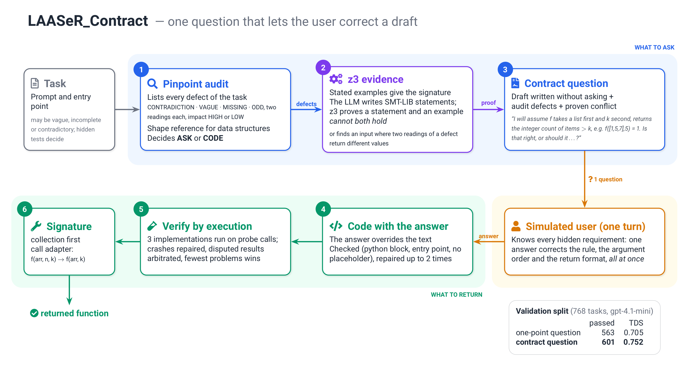

# LAASeR_Contract

Submission algorithm of team LAASeR - LIST: `clarify/algorithms/laaser_contract.py`, class
`LAASeR_Contract`.

## How it works

One question, written so that a single answer can correct everything a draft got wrong.

1. **Pinpoint audit** (`pinpoint_audit`). One LLM call lists every defect of the task
   (contradiction, vague, missing, odd; two readings each) and decides ASK or CODE.
2. **z3 evidence** (`z3_evidence`, `z3_question`). The task's statements are formalized as
   SMT-LIB and checked by z3 against the examples the task states: a statement and an example
   that cannot both hold, or two readings of a defect that return different values on a
   concrete input, are *proven* conflicts.
3. **Contract question** (`contract_question`). A draft is written without asking; the question
   states its contract (arguments and their order, return type and format, the rule, one
   example call) and asks the user to confirm it or say what it should do instead, settling the
   proven conflict first. The simulated user knows every hidden requirement, so one answer
   corrects the rule, the argument order and the format at once.
4. **Code with the answer** (`code_with_answer`). The answer overrides the task text; the code is
   checked and repaired up to twice.
5. **Verification by execution** (`verify_by_execution`). Three implementations run on probe
   calls in the sandbox; crashes are repaired, disputed results arbitrated, and the one with
   the fewest problems is kept.
6. **Signature fixes** (`fix_signature`). On tasks without a signature: collection-first
   argument order, and a wrapper that retries a call that does not bind (a redundant length,
   extra or missing arguments) with a generic alternative.

The benchmark is used only through `env.llm`, `env.ask_human` (once) and `env.exec_code`.

## Options (`DEFAULT_CONFIG`)

| Option | Default | What it does |
|---|---|---|
| `use_solver` | `True` | Use z3. `False` (or z3 not installed) skips the solver everywhere. |
| `z3_mode` | `"evidence"` | `"evidence"`: z3 on every task, its conflict feeds the always-asked contract question. `"on_code"`: the contract question only when the audit asks; z3 only when the audit would code. |
| `contract_drafts` | `1` | Drafts for the contract question; above 1 they run in the sandbox first. |
| `contract_order` | `True` | On tasks without a signature, the question names the argument order. |
| `question_samples` | `1` | Audits sampled when no contract question can be written (fallback). |
| `verify` | `True` | Verification by execution (step 5). |
| `candidates` | `3` | Implementations compared in step 5. |
| `reorder_arguments` | `True` | Collection-first argument order (step 6). |
| `call_adapter` | `True` | Wrapper for calls that do not bind (step 6). |
| `time_budget` | `240` | Wall-clock seconds per task; each LLM call waits at most 90 s. |

Example: `python generate_responses.py clarify/algorithms/laaser_contract.py --split val --use_solver False`.

## Requirements

- Python packages of the repository (`uv sync`), and Docker for `env.exec_code`.
- **Optional: z3** (`pip install z3-solver`, or `uv pip install z3-solver`). It is not in
  `pyproject.toml`; the import is guarded, so without it the algorithm runs as with
  `use_solver=False`.

### Why `time_budget`

The runner (`clarify/utils.py`, `BatchParallelProcessor`) restarts every unfinished task of a
batch from scratch as soon as one task runs longer than 300 s, up to 100 times, and LLM calls
have no timeout. The budget keeps each task below that limit: every LLM call is cut at 90 s,
and z3 and the verification are skipped when little time is left.

## Results (validation split, 768 tasks, `openai/gpt-4.1-mini`, temperature 0.7, one run each)

| Configuration | Passed | TDS | nDCG | $/task |
|---|---|---|---|---|
| defaults (z3 on every task) | 603 | 0.7520 | 0.9052 | 0.0044 |
| `use_solver=False` | 595 | 0.7420 | 0.8948 | 0.0028 |
| `z3_mode="on_code"` | 589 | 0.7359 | 0.8675 | 0.0027 |
| previous submission candidate (mean of 4 runs) | 563 | 0.7052 | ~0.86 | 0.0035 |

One run varies by about ±10 tasks. Tests: `tests/test_laaser_contract.py` (offline).
